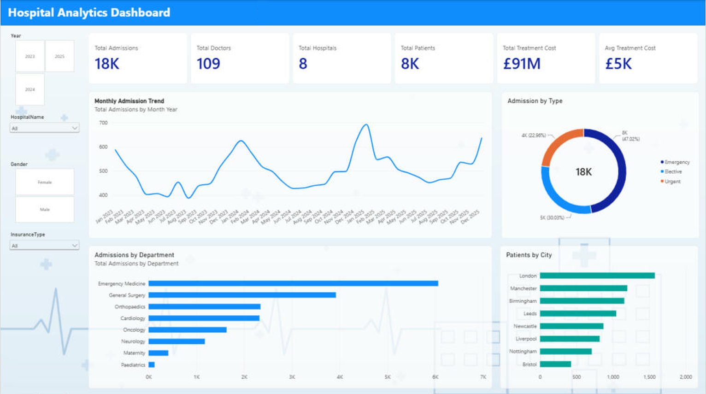
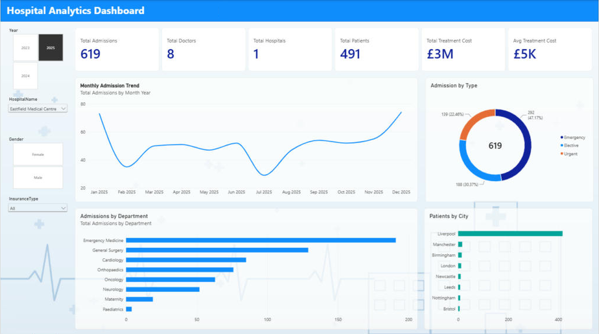
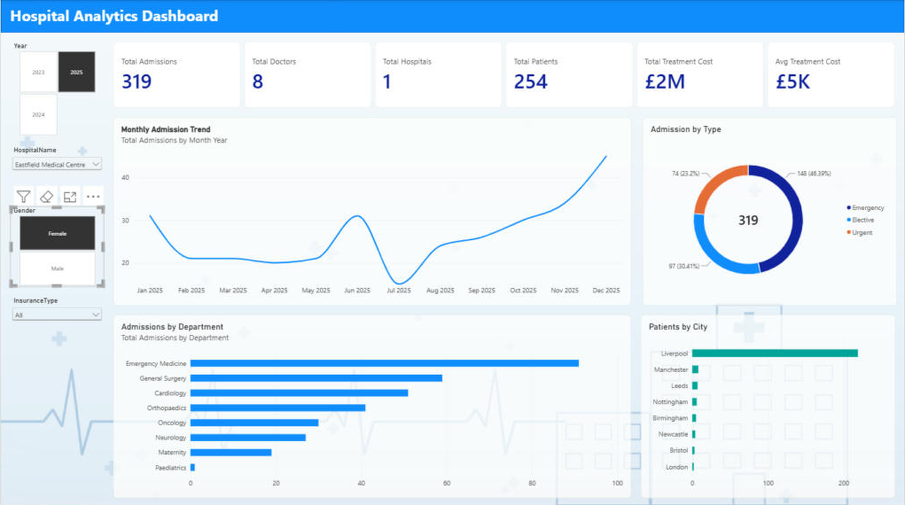

# 🏥 Hospital Analytics Dashboard | Power BI

An interactive Power BI dashboard analysing **18,000 hospital admissions** across **8 UK hospitals** and **109 doctors** (2023–2025).
Personal practice project built alongside my MSc in Business Analytics.



▶️ **Demo video:** [video/dashboard_demo.mp4](video/dashboard_demo.mp4)

---

## 📊 What the dashboard shows

| Area | Visual |
|---|---|
| Headline KPIs | Total admissions, doctors, hospitals, patients, total and average treatment cost |
| Trend | Monthly admissions, Jan 2023 – Dec 2025 |
| Mix | Admissions by type (Emergency / Elective / Urgent) |
| Workload | Admissions by department |
| Geography | Patients by city |
| Filters | Year, hospital, gender, insurance type |

## 💡 Key insights

- Admissions **peak every winter (Dec–Feb)**, about **37% higher** than summer.
- **47%** of admissions are emergencies.
- **Emergency Medicine** handles roughly a third of all admissions.
- **Oncology** has the highest average treatment cost (≈ £10.6k per admission).
- Patients aged **65+** are readmitted about **1.6× as often** as younger patients (12.8% vs 7.8%).
- Filtering to one hospital shows its local catchment. For example, most of Eastfield Medical Centre's patients come from Liverpool.

| 2025 · Eastfield Medical Centre | + Female patients |
|---|---|
|  |  |

## 🛠️ How it was built

**1. Data cleaning (Power Query)**
- Removed 7 duplicate admission rows (18,007 → 18,000)
- Standardised inconsistent text (`PRIVATE INSURANCE` → `Private Insurance`, `SELF-PAY` → `Self-Pay`)
- Converted Excel serial numbers to proper dates
- Fixed a table whose headers loaded as `Column1`, `Column2`
- Left missing satisfaction scores blank instead of 0, so averages stay accurate
- Added a `LengthOfStay` column: `Duration.Days([DischargeDate] - [AdmissionDate])`

**2. Data model**
Star schema with one fact table and five dimensions, all one-to-many:

```
                 DateTable
                     │
Patients ── Admissions (fact) ── Doctors
              │            │
         Hospitals    Departments
```

**3. DAX measures:** see [`dax/measures.dax`](dax/measures.dax)
`CALCULATE`, `DISTINCTCOUNT`, `DIVIDE`, and a custom calendar table.
I used `DISTINCTCOUNT(Admissions[DoctorID])` rather than `COUNTROWS(Doctors)`, so the doctor count responds to every slicer.

**4. Validation:** every KPI was checked against the source data before building visuals.

| Measure | Value |
|---|---|
| Total Admissions | 18,000 |
| Total Patients | 7,803 |
| Total Doctors | 109 |
| Total Treatment Cost | £91.5M |
| Avg Treatment Cost | £5,083 |
| Avg Length of Stay | 4.55 days |
| Readmission Rate | 8.9% |

## 📁 Repository contents

```
├── Hospital_Analytics_Dashboard.pbix   Power BI report (open in Power BI Desktop)
├── data/Hospital_Analytics_Dataset.xlsx   Source data (5 sheets)
├── dax/measures.dax                    All DAX measures and the Date table
├── images/                             Screenshots and canvas background
├── video/dashboard_demo.mp4            34-second walkthrough
└── docs/                               Step-by-step build guide
```

## 🗂️ Dataset

**Synthetic data** generated for portfolio practice. It contains no real patients or hospitals.

| Sheet | Rows | Description |
|---|---|---|
| Admissions | 18,007 (18,000 after cleaning) | One row per hospital stay |
| Patients | 9,000 | Demographics and city |
| Doctors | 109 | Doctor, department, hospital |
| Hospitals | 8 | Name, city, region, beds |
| Departments | 8 | Department names |

## ▶️ How to open

1. Install [Power BI Desktop](https://powerbi.microsoft.com/desktop/) (free, Windows).
2. Download `Hospital_Analytics_Dashboard.pbix` and open it.
3. If asked, point the data source to `data/Hospital_Analytics_Dataset.xlsx` (**Transform data → Data source settings → Change source**).

## 🧰 Tools

Power BI Desktop · Power Query (M) · DAX · Excel

---

**Yash Lodhi** · MSc Business Analytics
